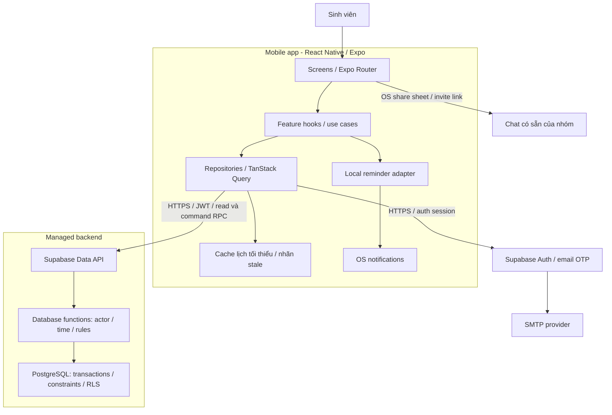
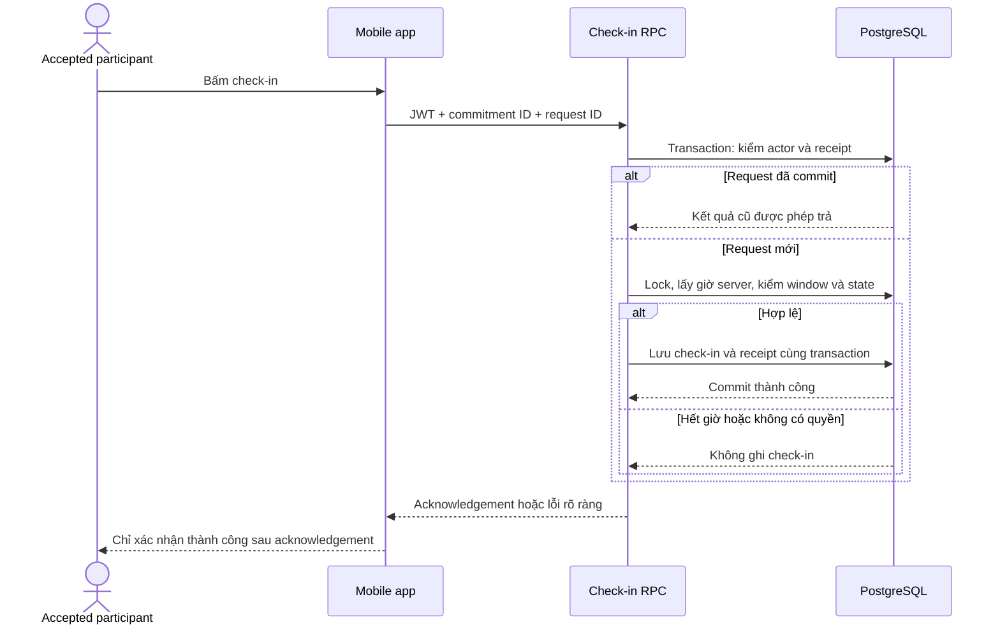

# Project Architecture

> 20/10/2026 · Kiến trúc được chọn cho hướng triển khai MVP: React Native + Expo + TypeScript và Supabase. Đây là bản thiết kế kỹ thuật, chưa phải hệ thống đã được xây dựng hoặc kiểm chứng trên thiết bị.

## 1. Architectural decision

LockIn sử dụng **kiến trúc module theo tính năng, phân lớp trong mobile app, kết hợp managed backend**. Mobile phụ trách giao diện, điều hướng và trạng thái hiển thị. Backend phụ trách danh tính, quyền truy cập, thời gian chuẩn và mọi thay đổi nghiệp vụ cần tính nhất quán.

Quyết định này phục vụ core path: **lịch cá nhân → tạo hẹn → mời bạn → RSVP → nhắc lịch → check-in → xem nhóm → tự báo kết quả**. Quy tắc chi tiết tiếp tục lấy từ [Product Rules & Metrics](17-Product-Rules-Metrics.md); kiến trúc không bổ sung public rooms, chat/video hay tự động phát hiện tập trung.

Nhóm có 4 thành viên, nhưng người phụ trách implementation và capacity chưa chốt. Vì vậy, ưu tiên một codebase mobile và một backend quản lý sẵn, với phạm vi đủ nhỏ để thử H1. Việc chọn stack không thay thế spike T-07 hoặc kết quả nghiên cứu về giá trị của app.

## 2. Technology stack

| Thành phần | Lựa chọn | Vai trò trong LockIn |
|---|---|---|
| Mobile | React Native + Expo + TypeScript | Một codebase cho Android/iOS, kiểu dữ liệu thống nhất; platform đưa vào pilot phải được T-07 xác minh |
| Navigation | Expo Router | Route cho lịch, lời mời, phiên học và auth; xử lý đường dẫn vào app |
| Server state | TanStack Query | Cache, loading/error, refetch và mutation; không dùng cache làm bằng chứng đã lưu |
| Local UI state | React hooks/context | Form, modal, filter, trạng thái auth; chưa cần thêm Redux/Zustand |
| Authentication | Supabase Auth, email OTP | Xác minh email để nhận đúng lời mời; không cần mật khẩu hoặc import contacts |
| Backend/data | Supabase PostgreSQL + database functions qua RPC | Dữ liệu quan hệ, transaction, kiểm tra quyền và quy tắc nghiệp vụ tại server |
| Authorization | Quyền SQL/RLS và kiểm tra actor trong RPC | Hạn chế dữ liệu theo creator, Pending invitee và Accepted member |
| Reminder | expo-notifications, local scheduling | Nhắc tùy chọn trên thiết bị; không phụ thuộc remote push ở MVP |
| Session storage | Adapter lưu auth session dùng vùng lưu bảo mật của hệ điều hành | Tách token khỏi cache giao diện; kiểm tra kích thước và vòng đời session trong T-07 |
| Build/release | Expo development build; EAS Build khi cần chia sẻ bản pilot | Kiểm thử link, notification và quyền trên bản cài thật |

Expo Router hỗ trợ điều hướng theo file và liên kết vào ứng dụng. Cần kiểm thử linking bằng development build với cấu hình riêng của app. [Expo Router](https://docs.expo.dev/router/introduction/), [Expo linking](https://docs.expo.dev/linking/overview/).

Supabase cung cấp Auth, PostgreSQL và database functions gọi từ client. Những capability này phù hợp với lựa chọn backend ở trên; tính đúng của quyền truy cập vẫn phải được nhóm thiết kế và kiểm thử. [Supabase Auth](https://supabase.com/docs/guides/auth), [Database functions](https://supabase.com/docs/guides/database/functions).

Không khóa số phiên bản trong tài liệu này. Khi scaffold, chọn Expo SDK stable và dependency tương thích, commit lockfile, ghi phiên bản runtime vào README kỹ thuật. Repo hiện tại vẫn là tài liệu và kế hoạch, chưa có app scaffold hoặc Supabase project được tạo bởi quyết định này.

## 3. System overview



MVP không cần một REST server tự vận hành, message broker hoặc microservices. Database functions là lớp nghiệp vụ phía server. Edge Functions chỉ bổ sung khi có nhu cầu như tích hợp dịch vụ ngoài; chưa cần cho core path hiện tại.

## 4. Mobile modules và dependency rules

| Lớp | Trách nhiệm | Quy tắc |
|---|---|---|
| Presentation | Screens, UI components, form, navigation | Không gọi Supabase trực tiếp hoặc tự quyết định check-in hợp lệ |
| Application/domain | Feature hooks/use cases, domain types, validation phục vụ UX | Điều phối create/RSVP/check-in/report; backend vẫn xác thực lại toàn bộ |
| Data/infrastructure | Repository, Supabase client, query keys, notification và storage adapter | Chuyển DTO sang domain model; xử lý lỗi, cache và server acknowledgement |

Dependency đi từ **screen → feature hook/use case → repository contract → adapter**. Không cần tạo interface cho từng hàm đơn giản; dùng contract ở ranh giới backend và thiết bị để có thể thay adapter khi kiểm thử. Query hooks không tự chứa SQL policy hoặc quy tắc giờ chuẩn.

Cấu trúc dự kiến khi bắt đầu implementation:

```text
lockin-mobile/
  app/                         # Expo Router routes, giữ screen wrapper mỏng
    _layout.tsx
    (auth)/
    (tabs)/
    invite/[token].tsx
    commitments/[id].tsx
  src/
    features/
      auth/
      schedule/
      commitments/
      invitations/
      participation/           # Check-in, shared view, outcome
      reminders/
    shared/
      ui/
      domain/                  # Kiểu dữ liệu, error codes, time display
      api/                     # Supabase client, generated database types
      storage/
      telemetry/
  supabase/
    migrations/                # Schema, constraints, grants, RLS, RPC
    tests/                     # Access và transaction tests
  tests/
    integration/
    e2e/
  docs/                        # Tài liệu hiện có
  planning/                    # Backlog hiện có
  scripts/                     # Công cụ tài liệu hiện có
```

Trong mỗi feature, tách `components`, `hooks`, `domain` và `data` khi có đủ code cần tổ chức. Không tạo sẵn nhiều thư mục rỗng. Feature khác dùng API công khai của module, tránh import sâu vào phần triển khai nội bộ.

## 5. Data model và invariants

| Entity | Dữ liệu chính | Ràng buộc cần có |
|---|---|---|
| `profiles` | `user_id`, `display_name` | Tham chiếu Auth user; không mở danh bạ profile công khai |
| `commitments` | `id`, `creator_id`, `purpose`, `starts_at`, `ends_at`, `display_timezone`, `cancelled_at`, `version` | `ends_at > starts_at`; giờ UTC bằng `timestamptz`; creator tạo giờ tương lai |
| `memberships` | `id`, `commitment_id`, `user_id` nullable trước khi nhận invite, `role`, `response`, `responded_at` | Creator Accepted; tối đa 4 slot gồm creator; một user không có hai membership trong cùng phiên |
| `invitations` | `id`, `membership_id`, `target_email`, `token_hash`, `expires_at` | Một lời mời cho mỗi slot; email và token hash ở dữ liệu private; hết hiệu lực khi start/cancel |
| `check_ins` | `membership_id`, `confirmed_at` | Tối đa một check-in cho membership; chỉ server ghi thời gian |
| `outcomes` | `membership_id`, `value`, `reported_at` | Self-report gắn với check-in; không cho sửa outcome của người khác |
| `command_receipts` | `actor_id`, `request_id`, `command`, `payload_hash`, `result` | Unique actor/request; ngăn retry tạo tác dụng lần hai |

Quan hệ chính: **user → memberships → commitment**; mỗi invitee slot có invitation, và mỗi membership có tối đa một check-in cùng một outcome. Token ngẫu nhiên đủ mạnh được server tạo; chỉ lưu hash. Nếu cần chia sẻ lại link sau khi mất token, cấp lại qua command được kiểm quyền và vô hiệu token cũ.

Create dùng một transaction để tạo commitment, creator membership và 1-3 invitee slots. Kiểm tra số lượng, email trùng và không tự mời chính mình tại server; khóa bản ghi khi cần để thao tác đồng thời không vượt giới hạn.

`Scheduled`, `Active`, `Ended` và `Expired` có thể là trạng thái hiệu lực được tính từ giờ server, response và `cancelled_at`. Không cần cron chạy đúng từng phút để phiên kết thúc hoặc lời mời hết hạn. Read và write đều phải kiểm tra trạng thái hiệu lực, kể cả khi cột response còn là Pending.

Attendance và outcome tách riêng: sau end, thiếu check-in là **Not confirmed**; thiếu self-report là **Unconfirmed**. Timer không tự ghi Completed. Đề xuất outcome đầu tiên là cuối cùng trong MVP; nếu cần sửa nhầm, phải bổ sung quy tắc và audit trước khi triển khai.

## 6. Authentication, invitation và privacy

### Identity và invite flow

1. Creator đăng nhập bằng email OTP, nhập 1-3 email bạn muốn mời; hệ thống không dò hoặc tiết lộ email đó đã có tài khoản hay chưa.
2. Server tạo các slot và link riêng. Creator chia sẻ link qua chat có sẵn; không gửi email invite tự động trong MVP.
3. Người nhận mở link, đăng nhập/xác minh email. Backend đối chiếu email đã xác minh của Auth user với `target_email`, không tin email/user ID do request body tự khai.
4. Trước Accept, RPC chỉ trả inviter, mục đích ngắn, giờ và policy cần cho quyết định. Token không tự cấp quyền xem roster.
5. Accept trước start gắn slot với Auth user trong transaction; Decline hoặc hết hạn không mở quyền session. Link sai danh tính, bị hủy hoặc không hợp lệ trả thông báo chung, không lộ email người được mời.

Email OTP yêu cầu cấu hình email template gửi mã thay vì mặc định gửi magic link. Dịch vụ SMTP mặc định của Supabase bị giới hạn cho địa chỉ thuộc team; **trước pilot với người ngoài phải cấu hình SMTP phù hợp và kiểm tra giao mã**. Không coi OTP là không có friction; T-07/T-04 phải đo thêm thời gian và lỗi onboarding. [Email OTP](https://supabase.com/docs/guides/auth/auth-email-passwordless), [SMTP restrictions](https://supabase.com/docs/guides/auth/auth-smtp).

Pilot dùng development build: nếu app đã cài, link mở route invite; nếu chưa cài, người tham gia được hướng dẫn cài bản pilot rồi mở lại link hoặc dán link vào app. Không hứa tự giữ lời mời xuyên qua bước cài app. App giữ intent khi chuyển sang auth, sau đăng nhập vẫn xác thực lại link. Universal/App Links có thể bổ sung khi nhóm có domain; deferred deep linking chưa thuộc MVP. [Linking into your app](https://docs.expo.dev/linking/into-your-app/).

### Access boundary

| Actor | Read | Write |
|---|---|---|
| Creator | Session, responses, roster và outcomes | Hủy trước start; check-in/report của bản thân |
| Đúng invitee, Pending còn hạn | Invite projection tối thiểu | Accept/Decline trước start |
| Accepted member | Session, roster, check-in và outcomes | Check-in/report của bản thân |
| Declined/Expired | Response của mình nếu cần | Không đổi dữ liệu phiên |
| Outsider/sai identity | Không có private details | Bị từ chối |

Không dựa vào ẩn nút trên UI để bảo vệ dữ liệu. Thiết kế bảng private hoặc thu hồi direct table grants; chỉ expose read projections/RPC cần thiết. Bật RLS cho bảng được expose, với quyền mặc định từ chối. Profile không có policy đọc toàn bộ chỉ vì người gọi đã đăng nhập. [Supabase RLS](https://supabase.com/docs/guides/database/postgres/row-level-security).

Command chỉ ghi qua RPC được kiểm soát. Nếu cần `security definer` để ghi bảng đã khóa direct writes, function phải kiểm `auth.uid()`, membership và thời gian ngay trong body; dùng `search_path` cố định, tên bảng có schema, thu hồi quyền execute mặc định và chỉ grant role cần thiết. Function loại này có thể vượt RLS, nên RLS không thay thế kiểm tra actor. Ưu tiên `security invoker` cho function không cần đặc quyền. [Function security](https://supabase.com/docs/guides/database/functions).

App chỉ chứa URL và publishable key cấu hình cho client, không chứa secret/service-role key. Token auth dùng adapter lưu bảo mật, kiểm thử refresh/logout/reinstall. Cache nhóm ở bộ nhớ; cache đĩa chỉ giữ lịch cá nhân tối thiểu, không lưu roster, email invitee hoặc token link lâu dài. Logout xóa cache, intent và reminder của tài khoản. [SecureStore và giới hạn lưu trữ](https://docs.expo.dev/versions/latest/sdk/securestore/).

## 7. Read API và command contracts

Các tên sau là contract đề xuất, chưa phải endpoint đã triển khai:

| Operation | Input chính | Validation/response |
|---|---|---|
| `list_my_schedule` | Cursor/range | Chỉ phiên được phép thấy; trả `server_now`, thời điểm cập nhật |
| `get_invitation` | Invite token | Đúng identity và còn hiệu lực; chỉ minimal projection |
| `get_session` | Commitment ID | Creator/Accepted; projection không gồm email hoặc token của invitee |
| `create_commitment` | Purpose, start/end/timezone, invitee emails, request ID | Validate và tạo toàn bộ slot trong transaction |
| `respond_to_invitation` | Token, Accept/Decline, request ID | Đúng invitee; trước start; không cancelled; không nhận lời thay người khác |
| `check_in` | Commitment ID, request ID | Accepted, chưa cancelled, trong window; trả thời gian/classification chuẩn |
| `report_outcome` | Commitment ID, outcome, request ID | Có check-in; Left early trước end hoặc Completed từ end; chỉ của actor |
| `cancel_commitment` | Commitment ID, request ID | Creator và trước start; vô hiệu invite, tăng version |

Không nhận `confirmed_at`, classification hoặc `actor_id` từ client làm dữ liệu đáng tin. Mỗi response có code rõ như `AUTH_REQUIRED`, `INVITE_UNAVAILABLE`, `WINDOW_CLOSED`, `SESSION_CANCELLED`, `REQUEST_CONFLICT`; lỗi nội bộ không trả chi tiết private/SQL cho app.

Idempotency dùng unique `(actor_id, request_id)` và payload hash. Cùng request/cùng payload trả kết quả đã commit; cùng ID/khác payload bị từ chối. Receipt và mutation commit cùng transaction. Retry vẫn phải xác thực actor và quyền hiện tại, không trả lại invite token/roster đã mất quyền. Response command không thay cho việc refetch trạng thái phiên hiện tại.

## 8. Check-in, time và concurrency

Một mốc `t_server` được lấy tại backend khi xử lý command, sau khi lấy lock cần thiết; cùng mốc dùng cho validation và lưu kết quả. Đây là cách định nghĩa kỹ thuật cho server-received time: không phải thời điểm bấm nút hoặc thời điểm gói tin đến điện thoại. Request bị chậm qua deadline có thể bị từ chối, phải hiển thị rõ trong UX.

PostgreSQL phân biệt thời gian đầu transaction với thời gian thực khi gọi `clock_timestamp()`. Implementation cần dùng mốc xử lý đã chọn một cách nhất quán, không lấy đồng hồ client hoặc vô tình dùng transaction dài làm thời gian nhận. [PostgreSQL date/time functions](https://www.postgresql.org/docs/current/functions-datetime.html).

- Check-in hợp lệ khi `start - 5 phút <= t_server < end` và actor Accepted.
- On-time khi `t_server <= start + 5 phút`, còn lại là Late trong window hợp lệ.
- Creator phải check-in riêng. RSVP và việc mở app không tạo attendance.
- Cancel và RSVP/check-in cùng khóa commitment trước khi đổi dữ liệu; mỗi command kiểm lại trạng thái sau lock. Không dựa vào dữ liệu UI đã tải trước đó.
- Countdown hiển thị từ `ends_at` và ước lượng offset `server_now`; khi resume/refetch thì tính lại. Timer chỉ phục vụ hiển thị.



Nếu mất response sau commit, app retry cùng request ID để lấy kết quả cũ, kể cả khi đã qua end; không tạo check-in mới sau end. Unique membership/check-in tiếp tục bảo vệ trường hợp người dùng gửi hai request ID khác nhau.

## 9. Synchronization, offline và reminders

**MVP chọn refetch/polling có giới hạn thay vì thêm Realtime ngay.** Refetch khi vào màn hình, app foreground, mạng trở lại và sau mutation. Shared view có thể poll khoảng 15 giây khi màn hình đang mở; đây là cấu hình khởi điểm cần đo, không phải SLA. Dừng polling khi background/rời màn hình. TanStack Query có cơ chế nối trạng thái network và AppState cho React Native. [React Native integration](https://tanstack.com/query/latest/docs/framework/react/react-native).

Hiển thị lần cập nhật cuối và trạng thái mất mạng. Shared view là bản ghi tham gia đã lưu, không phải live focus/presence. AppState chỉ dùng cho refetch, không quyết định attendance/outcome. Nếu pilot cần cập nhật nhanh hơn, cân nhắc Supabase Realtime sau khi kiểm lại quyền subscription và reconnect.

Offline cho phép xem lịch cache có nhãn chưa cập nhật. Form có thể giữ nháp trong bộ nhớ, nhưng tạo phiên/RSVP/check-in/report/hủy cần server acknowledgement. Không bật optimistic success hoặc queue mutation tự chạy khi app mở lại mà không thông báo. Retry do người dùng thực hiện, giữ request ID cho lần gửi có kết quả chưa rõ và để server kiểm lại deadline. Trước khi gửi lệnh mới sau timeout, ưu tiên refetch/đối soát lệnh cũ.

Local reminder chỉ đặt cho creator hoặc Accepted member đã bật nhắc và còn trước `start - 10 phút`. Lưu notification ID theo tài khoản/commitment để tránh trùng; đồng bộ lại khi app foreground. Quyền bị từ chối, nhắc trễ hoặc Accept sau mốc nhắc đều dùng lịch trong app làm fallback. Expo hỗ trợ đặt và hủy local notifications, nhưng giao nhắc còn phụ thuộc quyền và hệ điều hành. [Expo Notifications](https://docs.expo.dev/versions/latest/sdk/notifications/).

**Giới hạn cần phản ánh trong UX:** khi creator hủy, server vô hiệu lời mời ngay. Thiết bị đã đồng bộ sẽ hủy reminder local; thiết bị offline hoặc app bị đóng có thể vẫn hiện nhắc cũ. Khi mở nhắc phải tải lại trạng thái và hiển thị Cancelled sau khi xác minh; nếu offline thì báo chưa xác minh, không mở check-in như phiên còn hợp lệ. Local-only không bảo đảm xóa ngay notification trên mọi máy. Giới hạn này cần review trong T-11/T-14 trước pilot.

## 10. Testing, deployment và observability

| Phạm vi | Kiểm chứng trước pilot |
|---|---|
| Domain/SQL | Timezone, start/end, window tại đúng biên, expiry, tối đa 4 người, creator chưa check-in |
| Access | Outsider, sai email, Pending, Accepted, Declined/Expired; direct API và RPC đều không bypass được quyền |
| Transaction/retry | Hai lần Accept/check-in đồng thời; timeout sau commit; reuse ID khác payload; cancel đua với RSVP |
| Device integration | Auth session refresh, OTP delivery, cold/warm invite link, resume, mất mạng, permission denied, nhắc cũ sau cancel |
| End-to-end | Hai thiết bị đi hết FL-01/FL-02; từng người chỉ sửa record của mình; timer hết không tự Completed |

Dùng môi trường development và pilot tách dữ liệu/auth config, migration được commit và review. CI kiểm TypeScript/lint, unit/integration cần thiết và SQL access tests khi code tương ứng xuất hiện. Chỉ tạo bản pilot sau T-07/T-14 đạt acceptance; không đưa người dùng nghiên cứu vào môi trường developer dùng chung. Migration phá dữ liệu cần kế hoạch bảo toàn dữ liệu và rollback/forward fix riêng.

Log tối thiểu: request ID, event name, server timestamp, result/error code và ID giả danh khi có consent. Không log JWT, OTP, invite token, email hoặc mục đích học riêng tư. Server events sau commit phục vụ xác nhận RSVP/check-in/outcome; thời gian thao tác UI được đo riêng trong task test. Việc copy/share link không chứng minh người nhận đã nhận lời mời, nên không dùng nó làm delivered-invite denominator. Definition theo [Metric dictionary](17-Product-Rules-Metrics.md) và [Research protocol](18-Research-Protocol.md).

## 11. Alternatives và trade-offs

| Phương án | Đánh giá cho LockIn |
|---|---|
| Expo + Supabase, module theo feature | Chọn: một mobile codebase, mô hình quan hệ rõ, command có transaction; đổi lại cần viết SQL/RPC và kiểm quyền cẩn thận |
| Mobile + Firebase/Firestore | Có thể triển khai; không chọn cho bản thiết kế này vì muốn giữ membership/invitation/check-in và invariant trong PostgreSQL, giảm phân tán logic qua nhiều document |
| Flutter + backend tương tự | Có thể phù hợp nếu nhóm mạnh Dart; chưa có dữ liệu về năng lực đó, nên giữ TypeScript làm lựa chọn hiện tại |
| Backend riêng bằng Node/NestJS | Kiểm soát API tốt nhưng thêm phần deploy, auth integration và vận hành; chưa có nhu cầu đủ rõ ở MVP |
| Hai app native riêng | Tăng phần việc cho iOS/Android trong khi core interactions tương tự; chưa có capability bắt buộc lựa chọn này |
| Web/PWA prototype | Vẫn là phương án giảm scope nếu onboarding/install quá nặng; cần cân nhắc lại từ kết quả T-04/T-07 |

Các đánh giá trên là quyết định thiết kế theo phạm vi và nguồn lực chưa xác nhận, không phải benchmark chứng minh stack này nhanh/rẻ hơn. Không cam kết chi phí bằng 0: trước pilot cần kiểm quota, SMTP, build và thiết bị thực tế.

## 12. Implementation sequence và traceability

| Task hiện có | Bước triển khai theo kiến trúc |
|---|---|
| [T-07](https://github.com/Lockin-4everyung/lockin-mobile/issues/7) | Spike OTP/SMTP, invite cold start, secure session, access và retry trên thiết bị target; cập nhật effort và platform |
| [T-08](https://github.com/Lockin-4everyung/lockin-mobile/issues/8) | Figma thể hiện auth/invite, pending/error/stale, permission và cancellation paths |
| [T-09](https://github.com/Lockin-4everyung/lockin-mobile/issues/9) | Commitment schema/RPC, lịch, UTC/timezone, cancel |
| [T-10](https://github.com/Lockin-4everyung/lockin-mobile/issues/10) | Membership/invitation, email identity, read projection, RSVP và idempotency |
| [T-11](https://github.com/Lockin-4everyung/lockin-mobile/issues/11) | Local reminder adapter, permission/fallback, xử lý stale cancellation |
| [T-12](https://github.com/Lockin-4everyung/lockin-mobile/issues/12) | Server check-in, session query/polling và countdown |
| [T-13](https://github.com/Lockin-4everyung/lockin-mobile/issues/13) | Self-report outcome, lịch sử cá nhân và event tối thiểu |
| [T-14](https://github.com/Lockin-4everyung/lockin-mobile/issues/14) | Access/transaction/device tests, hai flow đầy đủ trước pilot |

Tài liệu này không chuyển các task sang Done và không tự phân công phần code. Những điểm T-07 cần chốt trước build gồm: thiết bị/platform pilot, năng lực TypeScript/SQL, chi phí SMTP/build, friction OTP và tính khả thi của link/reminder. Nếu spike không đạt, ghi lại quyết định thay đổi tại trang này và cập nhật [MVP scope](09-MVP-Scope-Impact-Effort.md), [Project plan](13-Project-Foundation-Plan.md) cùng backlog.
